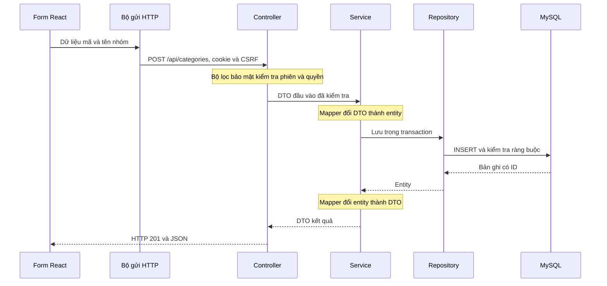

# Hướng dẫn đọc source quản lý vật tư

Tài liệu này giúp người mới tìm đúng file và hiểu tên kỹ thuật thường gặp. Chú thích ngay trên class và method viết bằng tiếng Việt; tên trong mã vẫn được giữ để liên kết giữa các tầng hoạt động như trước.

## 1. Nên đọc theo thứ tự nào?

1. `backend/src/main/java/vn/truong/warehouse/WarehouseApplication.java`: nơi khởi động backend.
2. `frontend/src/main.jsx`, rồi `App.jsx`: nơi khởi động giao diện, kiểm tra đăng nhập và chọn trang.
3. `frontend/src/resources.js`: bảng mô tả 20 trang, các cột, trường nhập và khóa liên kết.
4. Chọn một ví dụ nhỏ, chẳng hạn `MaterialCategoryController` → `MaterialCategoryService` → `MaterialCategoryRepository`; đọc kèm `MaterialCategory`, `MaterialCategoryDto`, `MaterialCategoryWriteDto`, `MaterialCategoryMapper`.
5. Đọc `auth/` khi muốn hiểu tài khoản và quyền; đọc migration SQL khi muốn hiểu bảng và ràng buộc dữ liệu.

Đường dẫn Java bên dưới đều nằm trong `backend/src/main/java/vn/truong/warehouse/`.

## 2. Những từ thường gặp

| Từ trong source | Ý nghĩa và nơi tìm |
| --- | --- |
| Class | Lớp, nhóm các dữ liệu hoặc hành vi có cùng vai trò. |
| Method | Phương thức/hàm thuộc lớp, thực hiện một việc cụ thể. |
| Controller | Cửa nhận yêu cầu từ giao diện và trả kết quả HTTP; thư mục `controller/` và `auth/AuthController`. |
| Service | Tầng xử lý nghiệp vụ, phối hợp đọc/ghi dữ liệu; thư mục `service/` và `auth/AuthService`. |
| Repository | Tầng truy cập database. Spring Data tự triển khai nhiều phương thức từ interface; thư mục `repository/`. |
| Entity | Đối tượng ánh xạ một bảng MySQL, gồm cột, khóa và kiểu dữ liệu; thư mục `entity/`. |
| DTO | Mẫu dữ liệu nhận hoặc trả qua các tầng; giúp không đưa nguyên đối tượng database ra ngoài; thư mục `dto/`. |
| WriteDto | Mẫu đầu vào khi tạo/sửa; có giới hạn bắt buộc, độ dài hoặc số thập phân. |
| Mapper | Bộ chuyển đổi entity ↔ DTO. Không tự lưu database và không thay thế kiểm tra nghiệp vụ. |
| Enum | Danh sách mã cố định, như DRAFT (bản nháp) và POSTED (đã ghi sổ); thư mục `enums/`. |
| ID / khóa chính | Giá trị định danh duy nhất một bản ghi. Khóa ghép gồm nhiều ID xét cùng nhau. |
| Khóa ngoại | ID liên kết tới bảng khác. Dự án giữ các liên kết bằng trường ID; MySQL kiểm tra tính hợp lệ. |
| Transaction | Một nhóm thao tác database được xử lý cùng nhau: nếu thất bại thì rollback, tức hoàn tác các thay đổi của nhóm. |
| Session | Phiên đăng nhập lưu ở backend. Trình duyệt giữ cookie định danh, không giữ mật khẩu đăng nhập. |
| CSRF | Cơ chế yêu cầu token đi kèm thao tác ghi để ngăn website khác giả mạo yêu cầu bằng cookie của người dùng. |
| Hash / BCrypt | Băm mật khẩu một chiều để lưu và kiểm tra; không phải lưu mật khẩu thô hoặc mã hóa có thể giải ngược. |
| Pagination | Phân trang; API danh sách chỉ đọc một phần dữ liệu mỗi lần. Chỉ số page bắt đầu từ 0. |

## 3. Luồng tạo nhóm vật tư

Các file cần đọc: `frontend/src/App.jsx` (Editor, submit), `frontend/src/api.js` (api), rồi `MaterialCategoryController`, `MaterialCategoryService`, `MaterialCategoryMapper` và `MaterialCategoryRepository`.

## 4. Đọc phần tài khoản

- `frontend/src/Auth.jsx`: form đăng nhập/đăng ký và trang tài khoản.
- `auth/AuthController`: API nhận yêu cầu, tạo/đổi ID phiên và trả hồ sơ.
- `auth/AuthService`: băm mật khẩu, đăng ký VIEWER, sửa họ tên và đổi mật khẩu.
- `auth/SecurityConfig`: khai báo API nào cần đăng nhập, vai trò nào được đọc/ghi và quy tắc CSRF.
- `auth/SessionAccountFilter`: kiểm tra lại tài khoản và quyền ở mỗi yêu cầu; mật khẩu đã đổi hoặc tài khoản bị khóa thì phiên cũ không được dùng tiếp.
- `auth/AuthPrincipal`: ID, tên đăng nhập và dấu nhận diện mật khẩu đã băm được giữ trong phiên; không có mật khẩu thô.

`ADMIN` = quản trị, `CLERK` = nhân viên kho, `APPROVER` = người phê duyệt, `VIEWER` = người xem. Vai trò APPROVER hiện được đọc; quy trình phê duyệt phiếu chưa được triển khai.

## 5. Dữ liệu kho cần đọc cẩn thận

- `MaterialService.create`: tạo vật tư và khởi tạo `InventoryBalance` bằng 0 cùng transaction; không tạo biến động nhập kho.
- `StockDocumentLine.baseQuantity`: MySQL tự tính từ số lượng × hệ số. Mapper không cho client ghi cột tự tính.
- `InventoryBalance.version`: dùng cho optimistic locking (khóa lạc quan), giúp phát hiện bản ghi đã bị phiên xử lý khác thay đổi khi lưu bằng JPA. Đây không phải toàn bộ quy trình chống xuất âm.
- `StockViewRepository`: đọc view tổng hợp từ sổ biến động. Kết quả lô/serial có thể NULL và không được gán ID giả.
- `StockDocument`, `StockMovement`, `DocumentAction`, `CostAllocation`: có entity/repository nhưng các service tương ứng hiện phục vụ đọc. Chưa có xử lý duyệt/ghi sổ/tính giá hoàn chỉnh.
- Các repository kế thừa phương thức lưu không có nghĩa là nên gọi lưu trực tiếp từ giao diện hoặc bỏ qua quy trình nghiệp vụ.

## 6. Những annotation thường thấy

| Annotation | Cách hiểu |
| --- | --- |
| `@Entity`, `@Table`, `@Column` | Ánh xạ lớp và thuộc tính sang bảng/cột MySQL. |
| `@Id`, `@IdClass` | Khóa chính và khóa gồm nhiều thành phần. |
| `@GeneratedValue` | ID do database sinh, không nhận ID tùy ý khi tạo. |
| `@Version` | Kiểm tra phiên bản để phát hiện xung đột khi ghi bằng JPA. |
| `@RestController`, `@GetMapping`, `@PostMapping`, `@PutMapping` | Khai báo API và loại yêu cầu đọc/tạo/sửa. |
| `@Service`, `@Component`, `@Repository` | Đăng ký thành phần để Spring tạo và kết nối các lớp với nhau. |
| `@Transactional` | Đánh dấu phạm vi transaction; readOnly=true dành cho thao tác đọc. |
| `@Valid`, `@NotBlank`, `@NotNull`, `@Size`, `@Digits` | Kiểm tra dữ liệu đầu vào. Ràng buộc MySQL vẫn là lớp kiểm tra bổ sung. |
| `@JsonIgnore` | Loại thuộc tính khỏi JSON; dùng với chuỗi mật khẩu đã băm. |

## 7. Cách đọc chú thích và test

Khối `/** ... */` phía trên class/method là Javadoc hoặc JSDoc. `@param` giải thích tham số; chú thích bên trong hàm giải thích bước xử lý hoặc lý do của quy tắc.

Backend có ba lớp test trong `backend/src/test/java/vn/truong/warehouse/`: `WarehouseIntegrationTest`, `WarehouseApiTest`, `AuthenticationTest`. Frontend có `frontend/tests/auth.spec.js` và `management.spec.js`. Đọc phần mô tả tiếng Việt trên từng ca test để biết hành vi nào được kiểm tra, thay vì chỉ đọc tên tiếng Anh.

Hướng dẫn chạy thực tế nằm trong `backend/README.md` và `frontend/README.md`. Tài liệu này giải thích mã hiện có, không khẳng định các nghiệp vụ chưa triển khai đã hoạt động.
